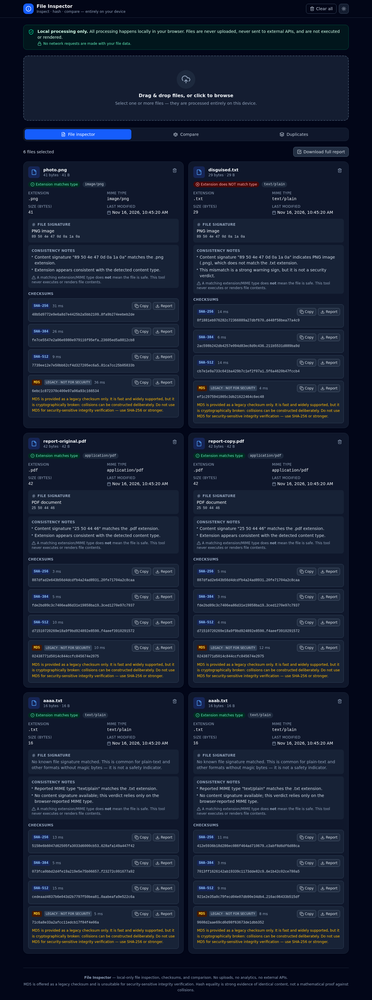
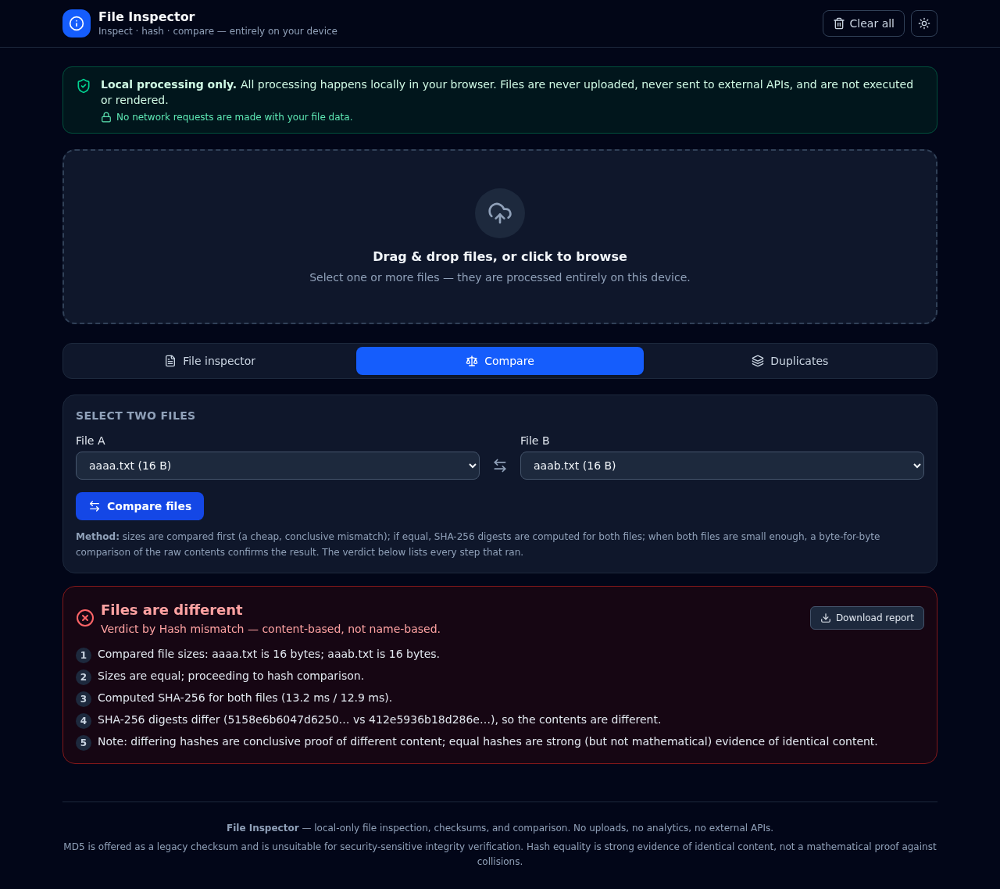
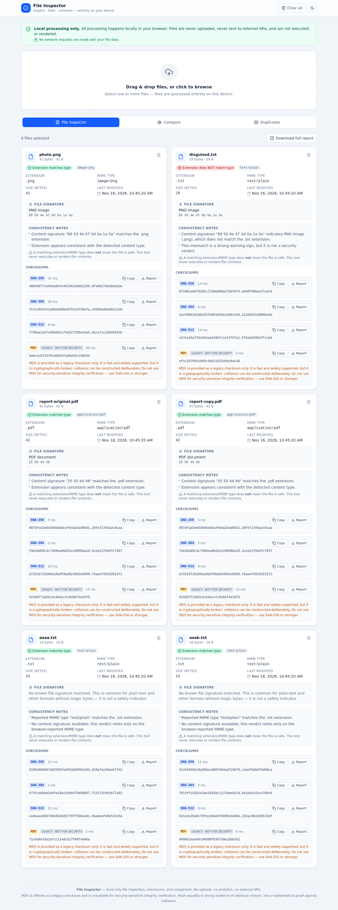

# File Inspector

**A professional, browser-based file inspection, checksum, and comparison utility — with 100% local processing.**

File Inspector lets you inspect local files, calculate cryptographic checksums, compare files byte-for-byte, and detect duplicates — without ever uploading a byte. All processing happens locally in your browser using the File APIs, the Web Crypto API, and a maintained client-side MD5 library.

> **Live Demo:** [https://majidramzi.github.io/file-inspector/](https://majidramzi.github.io/file-inspector/)

---

## Table of Contents

- [Screenshots](#screenshots)
- [Features](#features)
- [Supported Hash Algorithms](#supported-hash-algorithms)
- [Security Notes](#security-notes)
- [Browser Requirements](#browser-requirements)
- [Installation](#installation)
- [Development](#development)
- [Testing](#testing)
- [Build](#build)
- [Deployment](#deployment)
- [Privacy](#privacy)
- [Limitations](#limitations)
- [Project Structure](#project-structure)
- [Contributing](#contributing)
- [License](#license)

---

## Screenshots

**File inspector (light theme)** — metadata, file signature, consistency verdicts, and all four checksums:


**File inspector (dark theme)**:



**Comparison panel** — content-based verdict with the full step-by-step method:



**Duplicate detection** — grouped identical content with matching checksums:


**Checksum results** — copy buttons, MD5 legacy labels, and security notices:



---

## Features

### File information
- Select **one or multiple files** via drag-and-drop or the file picker
- Display of **file name**, **extension**, **MIME type**, **exact size in bytes**, **human-readable size**, and **last-modified timestamp**
- **File signature (magic byte) detection** for common formats: PNG, JPEG, GIF, BMP, WEBP, WAV, PDF, ZIP/OOXML/JAR, GZIP, 7z, RAR, ELF, PE, WASM, SQLite, MP3, MP4/M4A, FLAC, OGG, TIFF, ISO 9660, SVG, and more
- **Extension ↔ content consistency verdict** (`consistent` / `inconsistent` / `unknown` / `no extension`) with plain-language notes explaining *how* the verdict was reached
- Explicit warnings that a matching extension/MIME type **never** proves a file is safe

### Checksum generator
- **SHA-256**, **SHA-384**, **SHA-512** via the native **Web Crypto API** (`crypto.subtle.digest`)
- **MD5** as an optional legacy checksum via [spark-md5](https://github.com/satazor/js-spark-md5) — clearly labelled **“Legacy · not for security”** with an inline explanation that MD5 is cryptographically broken
- Per-hash **copy button** and **download report** button
- **Large-file handling**: files ≥ 256 MiB display an explicit notice that the native digest operation buffers the entire file in memory — it is **not** streaming hashing — and are hashed only on demand

### File comparison
- Compares **file size → SHA-256 hash → byte-for-byte content** (never file names)
- Clear **identical / different** verdict with the **method badge** (e.g. `Size mismatch`, `SHA-256 match`, `Byte-for-byte match`)
- **Step-by-step explanation** of exactly which checks ran and why the verdict follows
- Byte-for-byte confirmation is performed whenever both files are ≤ 256 MiB; larger pairs fall back to hash comparison and say so
- Downloadable comparison report

### Duplicate detection
- Hashes every selected file with a selectable algorithm (SHA-256 by default)
- Groups files with **identical content**, showing file names, sizes, the matching checksum, and total **reclaimable space**
- Explicit disclaimer: matching hashes are **strong evidence** of identical content, **not a mathematical proof** against collisions

### Interface
- Responsive layout (mobile → desktop), information cards, tabbed panels
- **Light and dark themes** (persisted, respects `prefers-color-scheme`, no flash on load)
- Helpful **empty states** and sample explanations throughout
- Downloadable plain-text **reports** for files, comparisons, and duplicate groups

### Privacy & security
- **Never uploads files** — there is no backend at all
- **Never sends file contents to external APIs** — the app makes no network requests with your data
- **Never executes or renders** uploaded files (no ``/`<iframe>`/eval of file contents)
- Temporary `File` references are **released when you remove files** or clear the list
- A persistent **local-processing privacy notice** is shown in the UI

---

## Supported Hash Algorithms

| Algorithm | Source | Status | Use case |
| --- | --- | --- | --- |
| SHA-256 | Web Crypto API | Recommended | General integrity verification, duplicate detection |
| SHA-384 | Web Crypto API | Supported | Higher-strength integrity checks |
| SHA-512 | Web Crypto API | Supported | Higher-strength integrity checks |
| MD5 | spark-md5 (client-side) | **Legacy only** | Checksums where compatibility matters and security does **not** |

> ⚠️ **MD5 is unsuitable for security-sensitive integrity verification.** It is fast and universally supported, but it is cryptographically broken: deliberate collisions can be constructed. Use SHA-256 or stronger whenever the result must be trusted.

---

## Security Notes

- **Web Crypto API requires a secure context.** `crypto.subtle` is only available over `https://` or on `localhost`. The app detects its absence and shows a clear error instead of failing silently.
- **A valid-looking extension or MIME type is not a safety signal.** Browsers derive MIME types from extensions; attackers rename files freely. File Inspector reports mismatches as warnings and *never* claims a file is safe.
- **Hash equality is strong evidence, not proof.** SHA-256 collisions are theoretically possible (none are known in practice). The UI states this wherever hashes are compared.
- **Large files are buffered in memory.** `crypto.subtle.digest` is not streaming; peak memory grows with file size. The app warns at ≥ 256 MiB and hashes such files only on explicit request.
- **No code execution.** File contents are read as bytes for hashing and comparison only — they are never rendered, parsed as HTML, or executed.

---

## Browser Requirements

| Browser | Minimum |
| --- | --- |
| Chrome | 63+ |
| Edge | 79+ |
| Firefox | 69+ |
| Safari | 14.1+ |

Requirements: **Web Crypto API** (`crypto.subtle`, secure context), **File API** (`File`, `Blob.arrayBuffer()`), **Drag & Drop API**, ES2020+ JavaScript. Internet Explorer is not supported.

---

## Installation

```bash
git clone https://github.com/majidramzi/file-inspector.git
cd file-inspector
npm install
```

---

## Development

```bash
npm run dev        # start the Vite dev server (http://localhost:5173)
npm run preview    # preview the production build locally
```

The Vite base path is set to `/file-inspector/` so the same build works on GitHub Pages.

---

## Testing

```bash
npm test           # run the Vitest suite once
npm run test:watch # watch mode
npm run typecheck  # TypeScript project references check
```

The suite (76 tests) covers:

- **File size formatting** — bytes/KB/MB/GB boundaries, invalid input
- **Hash generation** — known test vectors for SHA-256/384/512 and MD5 (`"abc"` and the empty string), empty files, unsupported algorithms
- **Same-file comparison** — identical content under different names → identical
- **Different-file comparison** — equal-size content differing by one byte → different; size mismatches short-circuit before hashing
- **Duplicate grouping** — 2- and 3-way groups, unique hashes excluded, null hashes ignored, waste accounting, ordering
- **Unsupported file handling** — empty files, missing MIME types, unknown signatures, unsupported algorithms
- **File metadata** — extension parsing, magic-byte detection, consistency verdicts, end-to-end `inspectFile`

---

## Build

```bash
npm run build      # type-check, then produce an optimized bundle in dist/
```

Output is static: `dist/index.html` + hashed assets, ready for any static host.

---

## Deployment

### GitHub Pages (automated)

The repository ships with [`.github/workflows/deploy.yml`](.github/workflows/deploy.yml), which runs **type check → tests → build** and deploys `dist/` to GitHub Pages on every push to `main`.

1. Push this repository to GitHub as `majidramzi/file-inspector`.
2. In the repository settings, set **Settings → Pages → Source** to **GitHub Actions**.
3. Push to `main` (or run the workflow manually from the **Actions** tab).

Expected URL: **`https://majidramzi.github.io/file-inspector/`**

The Vite `base` option is already configured:

```ts
// vite.config.ts
export default defineConfig({
  base: "/file-inspector/",
  // ...
});
```

### Manual / other hosts

```bash
npm run build
# upload the contents of dist/ to any static host.
# If hosted at a path other than /file-inspector/, adjust `base` in vite.config.ts.
```

---

## Privacy

- **No uploads.** Files are read with the local File API and never leave the device.
- **No network calls with your data.** There is no backend, no telemetry, and no analytics. The app works fully offline after loading.
- **No execution or rendering** of file contents.
- **Reference cleanup.** Removing a file (or clearing the list) drops the in-memory `File` reference and cancels pending hash work so the browser can reclaim the data.
- Reports are generated as local `Blob` downloads — they are written to your disk directly, not sent anywhere.

---

## Limitations

- **Not an antivirus.** File Inspector cannot determine whether a file is malicious. Consistency verdicts are heuristics, not security judgments.
- **MD5 is provided for compatibility only** and must not be used for security-sensitive verification.
- **Digests are not streaming.** Very large files (hundreds of MiB to GiB) may exhaust browser memory; the app warns before hashing them and will surface allocation errors rather than silently truncating.
- **Signature detection covers common formats** and the first 512 bytes only. Unknown or exotic formats report “no signature matched”, which is *not* a safety signal.
- **Byte-for-byte comparison is capped at 256 MiB per file** to protect browser memory; larger pairs are compared by SHA-256 with the fallback explained in the UI.
- **Hash collisions, while astronomically unlikely for SHA-256, are theoretically possible** — matching hashes are strong evidence of identical content, not a proof.
- **Cross-browser clipboard access** for the copy button requires a secure context and may be blocked by permissions; a failure is handled gracefully.

---

## Project Structure

```
file-inspector/
├── .github/
│   └── workflows/
│       └── deploy.yml          # CI: typecheck → test → build → GitHub Pages
├── public/
│   └── favicon.svg
├── src/
│   ├── components/             # UI components
│   │   ├── ComparePanel.tsx    # Two-file comparison UI + method explanation
│   │   ├── DropZone.tsx        # Drag & drop + file picker
│   │   ├── DuplicatePanel.tsx  # Duplicate grouping UI
│   │   ├── EmptyState.tsx      # Reusable empty states
│   │   ├── FileCard.tsx        # Metadata / signature / consistency card
│   │   ├── HashRow.tsx         # Single checksum row (copy, report, MD5 notice)
│   │   └── PrivacyNotice.tsx   # Local-processing notice
│   ├── hooks/
│   │   └── useTheme.ts         # Light/dark theme with persistence
│   ├── test/
│   │   └── setup.ts            # Vitest setup (Web Crypto + Blob polyfills)
│   ├── types/
│   │   └── index.ts            # Shared types & constants
│   ├── utils/                  # Pure logic, fully unit-tested
│   │   ├── comparison.ts       # Size → hash → byte comparison
│   │   ├── duplicates.ts       # Hash-based duplicate grouping
│   │   ├── fileMetadata.ts     # Extension, signature, consistency
│   │   ├── format.ts           # Size/timestamp/duration formatting
│   │   ├── hashing.ts          # Web Crypto SHA-* + spark-md5 MD5
│   │   └── report.ts           # Plain-text report generation & download
│   │   └── __tests__/          # Vitest suites (76 tests)
│   ├── App.tsx                 # State orchestration, tabs, layout
│   ├── index.css               # Tailwind CSS v4 entry
│   └── main.tsx                # React root
├── index.html
├── vite.config.ts              # base: "/file-inspector/", Vitest config
├── tsconfig.json / tsconfig.app.json / tsconfig.node.json
├── package.json
└── README.md
```

Architecture follows the required separation: **file metadata utilities**, **hashing utilities**, **file comparison**, **duplicate detection**, **UI components**, and **types** are independent modules; UI components consume the utilities and own no business logic.

---

## Contributing

Contributions are welcome!

1. Fork the repository and create a feature branch: `git checkout -b feature/my-change`
2. Make your changes with tests where practical
3. Ensure `npm run typecheck`, `npm test`, and `npm run build` all pass
4. Open a pull request describing the change and its motivation

Please keep processing local — any change that would send file data to a server will be rejected.

---

## License

[MIT](LICENSE)
